  <picture>
    <source media="(prefers-color-scheme: dark)" srcset="./assets/banner-dark.svg">
    <source media="(prefers-color-scheme: light)" srcset="./assets/banner-light.svg">
    
  </picture>

## `> sobre-mí`

- Me gusta armar sistemas completos: la base de datos, la API y la pantalla que usa la gente.
- Me importa que los proyectos estén bien organizados: documentación, pruebas y CI.
- Todavía no soy especialista en nada, pero me defiendo con varias herramientas y aprendo haciendo.

## `> stack`

| Nivel | Herramientas |
|---|---|
| **Lo que más uso** |  |
| **Lo que usé en proyectos** |    + Flyway (migraciones) · Render (deploy) |
| **Lo que estoy explorando** |    + Kysely · Better Auth |

## `> proyectos`

<!-- COMPLETAR: cuando el repo nuevo de Pragma sea público, cambiá **Pragma** por [**Pragma**](https://github.com/AndreaF5rnandez/NOMBRE-DEL-REPO) -->

| Proyecto | Qué es | Estado | Stack |
|---|---|---|---|
| **Pragma** | Sistema de cómputo, presupuesto y control de obra para constructoras argentinas. Lo estoy armando desde cero junto a un docente del área. | `etapa temprana` | Monorepo con pnpm · NestJS · TypeScript · Vitest · PostgreSQL · Flyway · GitHub Actions |
| **Plataforma para un comercio** | Proyecto en equipo. Plataforma operacional y analítica para un negocio: productos, clientes, stock y precios. | `fundación` | Monorepo con pnpm · NestJS · Next.js · PostgreSQL · Flyway · Docker · GitHub Actions · Render · Vercel · Tauri |
| Prototipo de Pragma | La primera versión: me sirvió para aprender y validar ideas. La estoy reemplazando por la nueva. | `en reemplazo` | Next.js · React · Supabase · Tailwind CSS |

## `> actividad`

  <picture>
    <source media="(prefers-color-scheme: dark)" srcset="https://github-readme-activity-graph.vercel.app/graph?username=AndreaF5rnandez&days=31&bg_color=0c141c&color=a9c4dc&title_color=a9c4dc&line=a9c4dc&point=e5484d&area=true&area_color=a9c4dc&hide_border=true&radius=10&custom_title=contribuciones%20%C2%B7%20%C3%BAltimos%2031%20d%C3%ADas">
    <source media="(prefers-color-scheme: light)" srcset="https://github-readme-activity-graph.vercel.app/graph?username=AndreaF5rnandez&days=31&bg_color=ffffff&color=1f2328&title_color=3b6e99&line=3b6e99&point=e5484d&area=true&area_color=a9c4dc&hide_border=true&radius=10&custom_title=contribuciones%20%C2%B7%20%C3%BAltimos%2031%20d%C3%ADas">
    
  </picture>

## `> contacto`

<!-- COMPLETAR (opcional): si querés sumar tu mail, borrá estas marcas de comentario y poné tu dirección.

-->
